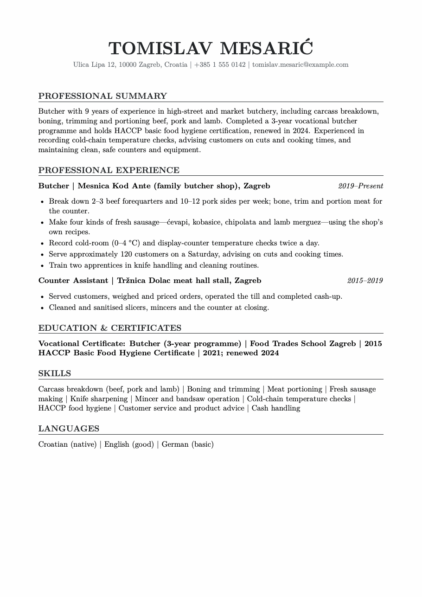

CV Editor
=========

**CV Editor rewrites your CV and writes a cover letter for one specific job ad, and gives you both as PDFs.** You give
it your current CV (or rough notes) and the job ad. It reads both, looks up the company, writes the two documents,
checks them for claims your material does not support, and turns them into PDFs. Then you ask for changes in plain
English ("add my research stay at Berkeley", "make the titles blue") until you are happy.

- **Who it is for:** job seekers who are comfortable with a terminal and installing a Python program. There is no
  website, app or download: it runs on your own computer from a terminal (written for macOS and Linux).
- **What it costs:** the program is free (MIT licence). Writing uses OpenAI's pay-per-use API: about **3 US cents**
  for a CV and a cover letter (measured mean $0.0275 per session on the project's test cases, 11 November 2026).
  Each change you ask for costs about 1 to 2 cents more. Company research uses Tavily, a web search service; it is
  optional. With a free local model ([below](#try-it-without-api-keys-local-model)) it costs nothing, but it is slow
  and the results are rough.
- **Your data:** your CV and the job ad are sent to OpenAI. If you set a Tavily key, a search query built from the
  ad's company details (name, website, location, industry) is sent to Tavily; your CV is not. With a local model
  nothing leaves your computer: the program makes no web search then, even when a Tavily key is set.
- **How long:** about 2 to 8 minutes for both documents (mean 3.9 minutes, 10 November 2026).
- **How well it works:** about as well as asking the same model once with everything in one message, at roughly ten
  times the cost. What the app adds is its guard rails: it asks for missing contact details and checks every claim
  against your material. See [How well does it work?](#how-well-does-it-work).

Made by Mislav Jordanic. Questions or ideas? Open an issue on GitHub.

Contents
--------

1. [How well does it work?](#how-well-does-it-work)
2. [What the output looks like](#what-the-output-looks-like)
3. [Quick Start](#quick-start)
4. [Try it without API keys (local model)](#try-it-without-api-keys-local-model)
5. [What you can give it](#what-you-can-give-it)
6. [Using it](#using-it)
7. [How it works](#how-it-works)
8. [Testing and evaluation](#testing-and-evaluation)
9. [Troubleshooting](#troubleshooting)
10. [Drawing the workflow graph](#drawing-the-workflow-graph)
11. [Roadmap](#roadmap)
12. [Licence](#licence)

How well does it work?
----------------------

The project tests itself on 13 fictional candidates and 8 job ads (no real people, no real users). The finished
documents are graded by an independent model (Claude Sonnet 5.5) or, in the conversations, by deterministic checks.
All results, with every document and grade, are published in [`evals/results/`](evals/results/).

**One CV and cover letter per job ad** ([report](evals/results/2026-11-11-core/REPORT.md), 11 November 2026, 39
matched cases, grades out of 10):

| system | overall | invented content (10 = nothing unsupported) | cost per session |
|---|---|---|---|
| **this app** (several model calls, writer `gpt-6-luna`) | 7.46 | 9.05 | $0.0275 |
| one call to the same model with everything in one message | 7.56 | 9.26 | $0.0027 |
| one call to a stronger model (`gpt-6.1-sol`) | 7.87 | 9.38 | $0.0436 |

OpenAI's model names: `gpt-6-luna` is the cheapest, `gpt-6.1-terra` costs 10 times as much per token and
`gpt-6.1-sol` 20 times (list prices in `provenance.py`).

- The app and one call to the same model **score about the same**: no difference on any main measure. The single
  call costs about a tenth as much.
- One call to the stronger model scores **0.41 points higher overall**. That difference is statistically clear, but
  smaller than the 1-point minimum effect the report measures it against.
- The grader found no fully unsupported claim in any system's final documents. The single calls stretched fewer
  claims (partly supported claims per 100: app 8.2, same-model call 4.5, stronger model 3.3).

**In a conversation, with edits** ([report](evals/results/2026-11-12-scenarios/REPORT.md), 12 November 2026, 13
scripted conversations, 138 sessions, against one model call per user turn):

- **Where the app does better:** it asked for missing contact details in 12 of 12 sessions; the plain one-call
  baseline asked in 7 of 12. A one-line hint in the baseline's prompt brings it to 10 of 12.
- **Elsewhere no difference was detected**, at about 4 to 9 times the cost and 2 to 5 times the time per turn. The
  widest gap favours the baseline: with 11 stacked edits it passed every check in 5 of 6 sessions, the app in 1 of 6
  (mostly cover letters over a 200-word limit). In both systems, appearance-only changes left the text unchanged in
  every session.
- **Known weaknesses:** the app's fact check can remove a job title you state about yourself in the chat (2 of 3
  runs of the current app); cover letters went over a word limit you set (5 of 6 runs); when what you say in the
  chat contradicts your own notes, every system kept to the notes (0 of 9).

**In short:** if you only want a first draft, one call to a good model does about as well for much less. The app's
value is its guard rails: it asks for missing contact details, checks claims against your material, removes
unsupported ones and tells you about any that remain.

These results are for fictional candidates graded by a model, and for the app as it was on those dates (commit
`25b7876` for the first table, `578b2ae` for the conversations). Method, caveats and how to rerun them:
[`evals/README.md`](evals/README.md).

What the output looks like
--------------------------

A CV and the start of its cover letter, made by the app in the evaluation of 11 November 2026 for a fictional
butcher applying to a fictional supermarket (the same person as `examples/sample_CV_butcher.txt`; contact details
are fake). The grader gave this session 9 out of 10 overall, above the 7.46 average, and found nothing invented.
The session took 2 minutes and cost $0.013.



> Dear Hiring Team,
>
> I am writing to apply for the Butcher / Meat Counter Assistant position at FreshCart Supermarkets' Zagreb-Jarun
> store. I bring nine years of meat-counter and butcher-shop experience, completed vocational butcher training, and
> HACCP Basic Food Hygiene certification renewed in 2024. ...

The grader's criticism of the same session: the letter mostly repeats the CV with little company-specific detail,
and both pages have large empty space. Every session's documents are in
[`evals/results/`](evals/results/) (`runs/<session>/outputs/`).

Quick Start
-----------

**You need:**

- [uv](https://docs.astral.sh/uv/getting-started/installation/), a free tool that installs Python 3.12 and the
  program's packages for you (the program needs Python 3.12 or newer; `.python-version` pins 3.12).
- LaTeX with the `pdflatex` command, the free typesetting system that makes the PDFs: on macOS
  `brew install --cask basictex` (or MacTeX), on Debian/Ubuntu `sudo apt install texlive-latex-extra`, on Windows
  MiKTeX. Check with `which pdflatex`.
- An [OpenAI API key](https://platform.openai.com/api-keys) (pay-per-use; about 3 cents a session, see above). Not
  needed with a [local model](#try-it-without-api-keys-local-model).
- Optional: a [Tavily API key](https://app.tavily.com) for company research (paid, with a limited free tier).
  Without one, company research is skipped and everything else works.

**Then, in a terminal:**

```bash
git clone https://github.com/mjordanic/CV_editor.git
cd CV_editor
uv sync                                    # creates .venv and installs the locked dependencies

cp .env_sample .env                        # then open .env and put your OpenAI key in it (Tavily key optional)

mkdir -p data/CV                           # data/ does not exist until you create it
cp examples/sample_CV.txt data/CV/CV.txt   # a made-up CV to try it; later put your own CV here

uv run python langgraph_agent.py
```

- `.env_sample` and `.env` start with a dot, so Finder and Explorer hide them by default; open `.env` from the
  terminal (`open -e .env` on macOS) or show hidden files.
- When the program asks for the job ad, type `job_description/sample_job_ad.txt` (a made-up ad that goes with the
  sample CV), then `END` on its own line. Then say what you want, e.g. "Please write my CV and cover letter.", and
  `END` again.
- **Your results** are in `data/generated_CVs/`: `generated_CV.pdf` and `generated_cover_letter.pdf` are the latest,
  and every draft is kept next to them.
- Type `exit` (then `END`) when you are done.
- On Windows the commands differ slightly (`copy` for `cp`, `mkdir data\CV`); these instructions assume macOS or
  Linux.

Try it without API keys (local model)
-------------------------------------

You can run every step on a free local model with [Ollama](https://ollama.com), a program that runs AI models on your
own computer. No OpenAI or Tavily key is needed, and nothing is sent anywhere: company research makes no web search
on a local model, even when `TAVILY_API_KEY` is set.

```bash
ollama pull gemma4:e4b            # a 9.6 GB download; or a smaller model, see below
ollama pull nomic-embed-text      # optional: only for a portfolio over 12,000 characters; without it that search is skipped
CV_EDITOR_MODEL=ollama:gemma4:e4b uv run python langgraph_agent.py
```

- **Expect it to be slow and rough.** On an M1 Mac with 16 GB, a full session on the sample files took about 30
  minutes with `gemma4:e4b`, and a CV-only session about 15 minutes. The model kept invented skills that the
  critique had flagged, and its LaTeX did not compile, so **no PDFs were produced**. Use a local run to see how the
  program works, not to judge its output or to make your application.
- **Model size.** `gemma4:e4b` (9.6 GB on disk) ran on a 16 GB Mac. Smaller downloads: `gemma4:e4b-it-qat`
  (6.1 GB), `qwen3:8b` (5.2 GB) or `gemma4:12b-it-qat` (7.2 GB, the best quality of these but the slowest).
- Local models get a 16k-token context (`CV_EDITOR_OLLAMA_NUM_CTX` to change it) and run with thinking off. A local
  `CV_EDITOR_MODEL` also runs the critic, so the log says "the checker shares the writer's model". All variables:
  [docs/how-it-works.md](docs/how-it-works.md#environment-variables).

What you can give it
--------------------

| input | where | notes |
|---|---|---|
| **Your CV** | `data/CV/CV.txt`, `CV.md` or `CV.pdf` | a text PDF; a scanned PDF has no text. If there is no CV and no notes, the program asks you to paste one or give a path |
| **An earlier cover letter** (optional) | `data/CV/cover_letter.*` (`.txt`, `.md`, `.pdf`) | used for facts and your voice; the new letter is written fresh for this job and addressed to this employer |
| **Free-form notes** (optional) | `data/CV/notes.*` (`.txt`, `.md`, `.pdf`) | anything about your career in any shape: a rough draft, bullet points, caveats ("exam booked, not passed yet"). Notes alone are enough to start: without a CV the program builds one from your notes and portfolio |
| **A portfolio** (optional) | `data/portfolio/portfolio.txt` | your projects and past jobs, one per paragraph (blank line between). `examples/sample_portfolio.txt` only shows the format and is never read |
| **The job ad** | pasted when asked, or a path to a file | `job_description/sample_job_ad.txt` and `sample_job_ad_butcher.txt` are made-up ads; `examples/sample_CV_butcher.txt` goes with the second |
| **A work-arrangement preference** (optional) | say it in the chat ("I only want remote jobs") | the documents state it only if you gave it, and you are told when the job conflicts with it. Without one you count as open to any arrangement |
| **Anything you say in the chat** | typed during the session | your requests are applied as you ask, also in your first message; what you say about yourself counts as your own facts |

Your CV, letter, notes, portfolio and what you say in the chat are the only facts the writers may use; the
invented-claims check compares every draft with them. `data/` and `job_description/` are in `.gitignore`, so your own
files are not committed by accident.

Using it
--------

```bash
uv run python langgraph_agent.py                 # (or: source .venv/bin/activate, then python langgraph_agent.py)
uv run python langgraph_agent.py --help          # the options, without starting a run
uv run python langgraph_agent.py --trace-dir DIR # also record every step and model call to DIR (API keys are never written)
```

- When the program waits for you ("Please paste the job description…", "Please provide your input:"), type or paste
  your text and finish with `END` on its own line, two empty lines in a row, or `Ctrl+D`. Empty lines inside pasted
  text are kept. For a long ad, save it to a file (e.g. in `job_description/`) and paste the path instead.
- The console shows the program's log: its questions appear as lines with a timestamp and `__main__ - INFO -` among
  the program's other log lines. Other libraries show only warnings there; everything is in `logs/`.
- One message can ask for several things, for both documents and for content and appearance at once:

  > Please create CV and cover letter. Add my research stay at Berkeley in 2021 to the CV. Also add MATLAB to my
  > skills. I want all titles in dark blue color and bolded. For the cover letter, emphasize my research experience
  > and make it more compact.

  The program then writes the CV and the letter one after the other, with no further questions in between.
- Appearance requests ("make it more compact", "use a sans-serif font") change only the PDF's look and keep the
  text.
- If your documents lack contact details, the program asks you once for them (or which to leave out) before it makes
  the PDF.

How it works
------------

The program is a set of cooperating steps (a LangGraph workflow), each one a model call or a check:

1. It reads your CV, earlier letter and notes, and asks for the job ad.
2. It looks up the company with Tavily, if you have a key, and notes the work arrangement and location.
3. It gives the writers your portfolio (only a very long one is searched for the relevant items).
4. A router reads the conversation and decides what to do next: write the CV, the letter, change a PDF's look, ask
   you something, or stop.
5. A writer drafts the document in the language of the job ad. A critic on a different model reviews it, including
   ATS compatibility (how applicant tracking systems read a CV), and a fact check lists claims your material does
   not support.
6. A draft with a real defect is redrafted, at most twice. The best draft is kept, any remaining unsupported claim
   is removed or shown to you, and missing contact details are asked for.
7. A model writes the PDF's LaTeX; LaTeX errors are repaired, and the PDF's text is compared with the checked text.
8. Your next request starts a new round; every draft stays on disk.

The full step-by-step description, the agents, configuration (`config/agent_models.yaml`), every environment
variable, logging and customisation are in **[docs/how-it-works.md](docs/how-it-works.md)**.

Testing and evaluation
----------------------

- **Offline tests:** `uv run pytest` runs the test suite without API keys. Four tests in
  `tests/test_analysis_calibration.py` need SciPy from the `analysis` dependency group and are skipped without it;
  `uv run --group analysis pytest` runs them too. Tests that compile LaTeX are skipped when `pdflatex` is missing.
- **Evaluation:** [`evals/`](evals/README.md) runs the program end to end on the tracked fictional candidates and
  ads, with a scripted user and recorded search results, and grades the documents with an independent model. It has
  the single-call baseline the results above compare with, a staged comparison with Anthropic Batch grading, an
  offline analysis notebook, and multi-turn conversation scenarios scored by deterministic checks. These tools make
  paid OpenAI and Anthropic calls; the ones that print plans and estimates (`--dry-run`, `--estimate`) do not.
- **Published results:** [`evals/results/`](evals/results/), summarised in
  [How well does it work?](#how-well-does-it-work).

Troubleshooting
---------------

- **`OPENAI_API_KEY is not set`** at startup: put the key in `.env` (copied from `.env_sample`, in the `CV_editor`
  folder), or use a [local model](#try-it-without-api-keys-local-model).
- **The program seems stuck:** it is probably waiting for you. Finish your input with `END` on its own line (or
  `Ctrl+D`).
- **Stopping:** type `exit` at any question (then `END`), or press `Ctrl+C`. Drafts made so far stay in
  `data/generated_CVs/`.
- **Feeding input from a file or pipe:** the program is meant to be typed into. Piped input ends each answer with
  `END` on its own line (empty lines are kept), and the session ends when the input runs out.
- **Missing pdflatex:** make sure `pdflatex` is on your `PATH` (`which pdflatex`); install commands are in
  [Quick Start](#quick-start).
- **LaTeX errors / no PDF:** the program repairs LaTeX errors automatically (two attempts), then tells you if it
  still failed. Check `logs/` for the LaTeX error. Local models fail here often.
- **A scanned PDF CV** has no text to read: save your CV as `.txt` or a text PDF, or paste it when asked.
- **Graphviz / `pygraphviz` build errors:** only relevant for `uv sync --extra graph` (redrawing the workflow
  picture, below). A plain `uv sync` does not need Graphviz.

Drawing the workflow graph
--------------------------


The picture shows how the steps are wired; it was drawn from the code on 12 November 2026. A normal run does not
touch it. To redraw it after changing the graph, install the Graphviz system library and the optional `graph`
extra:

```bash
# macOS (Homebrew)
brew install graphviz
CFLAGS="-I$(brew --prefix graphviz)/include" LDFLAGS="-L$(brew --prefix graphviz)/lib" uv sync --extra graph

# Debian/Ubuntu
sudo apt install graphviz graphviz-dev
uv sync --extra graph
```

Then either of:

```bash
# draws the picture without starting a session; needs no API key
CV_EDITOR_MODEL=ollama:gemma4:e4b uv run --extra graph python -c "from langgraph_agent import MasterAgent; MasterAgent().draw_graph()"

# draws the picture, then starts a normal session (needs an OpenAI key or a local CV_EDITOR_MODEL)
uv run --extra graph python langgraph_agent.py --draw-graph
```

Both overwrite `images/graph_visualization.png`. `--draw-graph` builds every agent first, so without an OpenAI key or
a local `CV_EDITOR_MODEL` it stops at startup like a normal run, and after drawing it waits for a job ad like a normal
run. The first command uses an Ollama model name only so that no OpenAI key is needed; Ollama itself does not have
to run.

Roadmap
-------

Done: PDF generation with LaTeX, quality review with automatic redrafts and a fact check, YAML configuration,
documents in the job ad's language (the evaluation covers a German ad; a language you ask for instead is supported
but not evaluated), free-form notes and chat facts as candidate material, asking for missing contact details, an
offline test suite and an end-to-end evaluation.

Open:

- **From the evaluation** ([scenarios report](evals/results/2026-11-12-scenarios/REPORT.md)): let facts you state
  about yourself in the chat pass the fact check; hold a word limit you set for the cover letter; decide what wins
  when the chat contradicts your own notes; evaluate documents written in a language you ask for.
- **Candidate information:** accept any document type (certificates, transcripts, etc.) and build a more complete
  picture of the candidate's skills, aspirations and experience; ask proactively for missing information beyond
  contact details.
- **ATS:** dedicated tooling beyond the critic's ATS review, such as keyword and format checks.
- **Multi-format export:** Word, HTML or Markdown besides PDF and plain text.
- **Template system:** choose between CV and cover letter styles.
- **Batch processing:** tailored documents for several job ads in one run.
- **Web interface:** a web UI next to or instead of the terminal.
- **Integrations:** professional networks (LinkedIn), job boards, document storage (Google Drive, Dropbox).
- **CI/CD:** the offline tests exist (434); there is no CI pipeline yet.

Licence
-------

MIT, see [LICENSE](LICENSE). Made by Mislav Jordanic.
