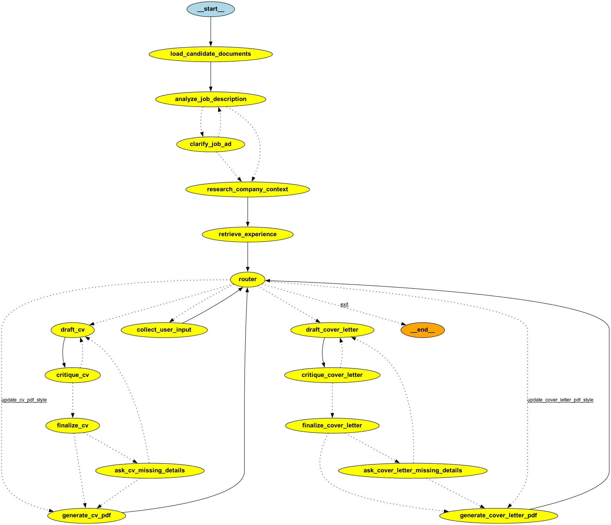

CV Editor
=========

CV Editor helps job seekers tailor a CV and cover letter to one specific job ad. You give it your current CV and the text of the ad. It reads both, looks up the company, writes a matching CV and cover letter, and turns them into PDFs. You can then ask for changes in plain English ("add my research stay at Berkeley", "make the titles blue") until you are happy. It runs on your own computer from a terminal, so it is aimed at people who are comfortable installing a Python program. It uses paid OpenAI and Tavily accounts: your CV and the job ad are sent to those services, and each run costs a small amount in API fees.

Table of Contents
-----------------

1. [Quick Start](#quick-start)
2. [Features](#features)
3. [High-Level Architecture](#high-level-architecture)
4. [Prerequisites](#prerequisites)
5. [Project Setup](#project-setup)
6. [Environment Variables](#environment-variables)
7. [Running the Agent](#running-the-agent)
8. [Workflow Walkthrough](#workflow-walkthrough)
9. [Logging and Debugging](#logging-and-debugging)
10. [Configuration](#configuration)
11. [Customization Tips](#customization-tips)
12. [Troubleshooting](#troubleshooting)
13. [Drawing the workflow graph](#drawing-the-workflow-graph)
14. [Licence](#licence)

Quick Start
-----------

You need Python 3.12, [uv](https://docs.astral.sh/uv/), a LaTeX install with `pdflatex` (see [Prerequisites](#prerequisites)), an OpenAI API key and a Tavily API key.

```bash
git clone https://github.com/mjordanic/CV_editor.git
cd CV_editor
uv sync                                    # creates .venv and installs the locked dependencies

cp .env_sample .env                        # then put your real keys in .env

mkdir -p data/CV
cp examples/sample_CV.txt data/CV/CV.txt   # or put your own CV here as data/CV/CV.txt or data/CV/CV.pdf

uv run python langgraph_agent.py
```

- **Your CV** goes in `data/CV/` as `CV.txt` or `CV.pdf`. An existing cover letter is optional (`data/CV/cover_letter.txt` or `.pdf`). `examples/sample_CV.txt` is a made-up CV you can use to try the program.
- **Your projects and past jobs** go in `data/portfolio/portfolio.txt`, one item per paragraph (separated by a blank line). Only that file is read. The one in the repository is a made-up example; replace it with your own.
- **The job ad**: when asked, paste the ad text or a path to a file. `job_description/sample_job_ad.txt` is a made-up ad for trying it out.
- **Costs**: right after startup the program makes paid OpenAI calls (it indexes your portfolio before you type anything), and every step after that makes paid OpenAI and Tavily calls.
- The `data/` and `job_description/` folders are in `.gitignore`, so your own CV and ads are not committed by accident.

Features
--------

- **Smart Experience Retrieval (RAG)**: Automatically retrieves relevant projects and experiences from your portfolio (`data/portfolio/portfolio.txt`) based on the job description.
- **Relevance Verification**: Uses a two-stage filtering process (Vector Similarity + LLM Verification) to ensure only truly relevant experience is included.
- **Automatic Refinement**: Documents can be refined automatically based on critique feedback, up to `max_refinements` rounds (off by default in the shipped config; see [Configuration](#configuration)).
- **Version Control**: All document iterations are saved as draft versions with quality scores.
- **Structured Data**: Centralized data management in `data/` folder (`CV`, `portfolio`, `generated_CVs`).
- **Flexible Input**: Supports reading job descriptions from text files (`job_description/`).
- **Human-in-the-loop**: You steer the AI at every decision point.
- **Intelligent PDF Generation**: 
  - **LLM-Powered LaTeX Generation**: The system uses an LLM to generate complete LaTeX documents (including preamble and content), not just filling template placeholders. This allows for full customization of document structure, styling, and formatting.
  - **Natural Language Style Customization**: Specify PDF appearance preferences in plain English (e.g., "make titles blue and bolded", "use minimal spacing", "make it more compact"). The LLM modifies the LaTeX code accordingly.
  - **Post-Hoc Style Modifications**: Change PDF appearance after generation without regenerating content. Simply describe the desired changes and the system updates the PDF styling.
  - **Compiler-in-the-Loop Error Fixing**: Automatic LaTeX compilation error detection and fixing using an LLM. The system attempts to fix compilation errors iteratively (configurable max iterations).
  - **Automatic Versioning**: Each PDF generation creates a draft version (`generated_CV_draft_N.pdf`). The latest version is always copied to `generated_CV.pdf` and `generated_cover_letter.pdf` for easy access.
- **Advanced Feedback System**:
  - **Separate Feedback Fields**: Provide feedback separately for CV and cover letter, each with distinct content and style feedback fields.
  - **Combined Feedback in Single Messages**: Include both content modifications and style preferences in a single message. For example: "Add my research stay at Berkeley. Make titles blue and bolded."
  - **Sequential Execution**: Request both CV and cover letter in one message, and the system will generate them sequentially without asking for additional input between documents.
  - **Intelligent Routing**: The router uses conversation history to understand user intent, automatically routing to generate missing documents when both were requested.

High-Level Architecture
-----------------------

- **LangGraph Orchestrator (`MasterAgent`)**: Builds the workflow graph, handles streaming execution, and coordinates interrupts for user input.
- **DocumentReaderAgent**: Loads user-provided documents from disk.
- **JobDescriptionAgent**: Pauses execution to request a job description, then extracts structured data.
- **SearchAgent**: Queries Tavily, summarizes results, and determines remote-work stance.
- **ExperienceRetrievalAgent**: Retrieves relevant experience from your portfolio using RAG (Retrieval-Augmented Generation) with relevance verification.
- **RouterAgent**: Uses conversation context and LLM reasoning to decide the next action (generate CV, cover letter, prompt user, exit). Intelligently handles sequential document generation when both are requested.
- **CVWriterAgent / CoverLetterWriterAgent**: Generate tailored drafts using LangChain chat models with iterative refinement based on critique feedback.
- **CritiqueAgent**: Evaluates generated documents for quality, ATS compatibility, and job alignment. Provides actionable improvement instructions and quality scores.
- **CVPDFGenerator / CoverLetterPDFGenerator**: Convert generated text documents to professional PDFs using LLM-generated LaTeX. Supports style customization, error fixing, and automatic versioning.
- **LatexFixer**: LLM-based agent that automatically fixes LaTeX compilation errors by analyzing error logs and generating corrected LaTeX code.
- **UserInputAgent**: Collects free-form responses when more clarity or feedback is required.

All agents share a common `State` TypedDict managed by LangGraph, which keeps track of messages, extracted info, generated artifacts, critique feedback, and version history. The result is a cohesive AI agentic system where multiple specialized models collaborate.

Prerequisites
-------------

- Python 3.12 or newer (`pyproject.toml` requires `>=3.12`; `.python-version` pins 3.12).
- [uv](https://docs.astral.sh/uv/) to install the dependencies from `uv.lock`.
- An OpenAI API key (paid, pay-per-use). The shipped `config/agent_models.yaml` uses `gpt-5-nano` for every agent; you can switch agents to `gpt-5-mini` or other models there.
- A Tavily API key for company research (paid, with a limited free tier).
- A LaTeX distribution for PDF generation, with the `pdflatex` command available: MacTeX or BasicTeX on macOS (`brew install --cask basictex`), TeX Live on Linux (`sudo apt install texlive-latex-extra`), or MiKTeX on Windows.
- macOS/Linux (Windows works but paths/logging instructions assume POSIX).

Project Setup
-------------

```bash
git clone https://github.com/mjordanic/CV_editor.git
cd CV_editor

# create .venv and install the exact dependency versions from uv.lock
uv sync
```

Graphviz is **not** needed to run the program. It is only needed if you want to redraw the workflow picture (see [Drawing the workflow graph](#drawing-the-workflow-graph)).

Environment Variables
---------------------

Copy the sample file and fill in your keys (or set the variables in your shell):

```bash
cp .env_sample .env
```

```
OPENAI_API_KEY=sk-...
TAVILY_API_KEY=tvly-...
```

`dotenv` loads these before any agent imports, so keep `.env` up to date.

Running the Agent
-----------------

```bash
uv run python langgraph_agent.py
```

(or `source .venv/bin/activate` and then `python langgraph_agent.py`)

`uv run python langgraph_agent.py --help` lists the options without starting a run. `uv run pytest` runs the offline tests (no API keys needed).

The program will:

1. Load user CV/cover-letter data from `data/CV/`.
2. Load portfolio data from `data/portfolio/portfolio.txt`.
3. Ask you to paste the target job description (or provide a file path).
4. Fetch company insights via Tavily.
5. Retrieve relevant experience from your portfolio.
6. Chat with you about what to generate next.
7. Produce tailored documents and save them to `data/generated_CVs/`.

While streaming, the CLI may pause with prompts such as “Please paste the job description…” or “Please provide your input:”. Paste multiline text and finish with `Ctrl+D`, two empty lines in a row, or `END` on its own line.

**Tip:** For long job descriptions that might exceed terminal buffer limits, you can save the text to a file (e.g., `job_description/sample_job_ad.txt`) and simply paste the file path when prompted.

**Example Workflow:**
```
User: "Please create CV and cover letter. Add my research stay at Berkeley in 2021 to the CV. 
       Also add MATLAB to my skills. I want all titles in dark blue color and bolded. 
       For the cover letter, emphasize my research experience and make it more compact."

System: [Generates CV with content and style changes]
        [Generates cover letter with content and style changes]
        [No additional prompts needed - sequential execution]
```

Workflow Walkthrough
--------------------

1. **Document ingestion**: `DocumentReaderAgent` loads `data/CV/CV.(txt|pdf)` and `data/CV/cover_letter.(txt|pdf)`.
2. **Job description capture**: `JobDescriptionAgent` interrupts for pasted text or file path (e.g., `job_description/sample_job_ad.txt`), extracts company name, work type, requirements, etc.
3. **Company research**: `SearchAgent` builds a Tavily query, summarizes results with an LLM, and determines remote-work support.
4. **Experience Retrieval**: `ExperienceRetrievalAgent` searches your portfolio (`data/portfolio/portfolio.txt`) for projects relevant to the job description. It uses vector similarity (threshold defined in `config/agent_models.yaml`) and an LLM to verify relevance.
5. **Routing decision**: `RouterAgent` considers chat history, existing outputs, and user feedback to pick the next node.
6. **Generation**:
   - `CVWriterAgent` creates or updates a CV using the selected LLM.
   - `CoverLetterWriterAgent` creates or updates a cover letter (often leveraging the freshly generated CV).
7. **Quality assessment and refinement**:
   - `CritiqueAgent` evaluates generated documents on three dimensions: content quality, ATS compatibility, and job alignment.
   - Provides a quality score (0-100) and actionable improvement instructions.
   - All document iterations are saved to version history with their quality scores as draft files.
   - If the quality score is below the threshold (default: 85) or critical issues are found, the document can be refined automatically, up to `workflow.max_refinements` times. **The shipped config sets `max_refinements: 0`, so automatic refinement is off by default** and the first draft goes straight to finalization; raise the value to turn it on.
8. **Final selection**: The highest-scoring version from the iteration history is selected as the final output.
9. **PDF Generation**: 
   - `CVPDFGenerator` and `CoverLetterPDFGenerator` convert the final text documents to professional PDFs.
   - The LLM generates complete LaTeX documents based on the text content and any style preferences.
   - LaTeX compilation errors are automatically fixed using the `LatexFixer` agent (up to a configurable number of iterations).
   - Each generation creates a draft version (`generated_CV_draft_N.pdf`), with the latest always available as `generated_CV.pdf`.
10. **User feedback loop**: 
   - The router intelligently extracts content and style feedback from user messages.
   - You can provide feedback for both CV and cover letter in a single message.
   - Content feedback modifies the text, while style feedback modifies PDF appearance.
   - If both documents are requested, the system generates them sequentially without additional prompts.
   - `UserInputAgent` interrupts the graph when clarification is needed, allowing you to provide instructions that reset version history and initiate new refinement cycles.

Logging and Debugging
---------------------

- **Structured logs**: Stored in `logs/cv_editor_<timestamp>.log`.
- **Debug transcripts**: `debug/cv_editor_<timestamp>.log` captures prompts, state snapshots, and generated text segments for auditing.
- **Graph visualization**: Not drawn on a normal run. See [Drawing the workflow graph](#drawing-the-workflow-graph).

Configuration
-------------

The system uses a centralized YAML configuration file (`config/agent_models.yaml`) to manage AI models and workflow settings. This approach provides a single source of truth for all configuration, making it easy to adjust behavior without code changes.

**Key Configuration Options:**
- **Agent Models**: Each agent (CV writer, cover letter writer, router, critique, etc.) can be configured with specific models and temperatures.
- **Refinement**: `workflow.max_refinements` sets how many automatic refinement rounds are allowed. The shipped value is `0` (automatic refinement off).
- **LaTeX Fixer**: Configure `max_latex_fix_iterations` in the `workflow` section to control how many times the system attempts to fix LaTeX compilation errors automatically (shipped value: 2; the code falls back to 1 if the key is missing).
- **Quality Thresholds**: Set quality score thresholds for automatic refinement in the critique agent configuration.
- **RAG Settings**: Configure vector similarity thresholds and relevance verification settings for experience retrieval.

All agents load configuration at startup from the YAML file. No code changes needed to adjust models or workflow parameters.

Customization Tips
------------------

- **Models**: Change model IDs or temperatures in `config/agent_models.yaml` (e.g., `cv_writer` uses `temperature: 0.2`). Ensure the chosen model is available in your OpenAI organization.
- **Prompt tone**: Update the system/human prompt strings in each agent to reflect a different writing style or formatting rules.
- **PDF Templates**: Base LaTeX templates are in `templates/` directory. The LLM uses these as starting points but can modify them completely based on your style preferences.
- **PDF Style Customization**: Provide style preferences in natural language when generating PDFs. Examples:
  - "Make all titles dark blue and bolded"
  - "Use minimal spacing and make it more compact"
  - "Change the font to Arial and increase margins"
  - The LLM will modify the LaTeX code (including preamble) to implement these changes.
- **LaTeX Error Fixing**: Configure `max_latex_fix_iterations` in `config/agent_models.yaml` to control how many times the system attempts to fix LaTeX compilation errors automatically.
- **State fields**: Extend `State` in `langgraph_agent.py` if you want to track additional data between nodes.
- **Alternate search providers**: Replace `SearchAgent.search_tavily` with another API if Tavily isn't desired. Just keep `company_info` schema consistent.

Troubleshooting
---------------

- **Graphviz / `pygraphviz` build errors**: Only relevant for `uv sync --extra graph`; see [Drawing the workflow graph](#drawing-the-workflow-graph). A plain `uv sync` does not need Graphviz.
- **Tracing interrupts**: If the CLI seems stuck, make sure you finished input with `Ctrl+D` or typed `END` on its own line.
- **LaTeX compilation errors**: If PDF generation fails repeatedly, check the logs for LaTeX error messages. The system will attempt to fix errors automatically, but some issues may require manual template adjustments.
- **Missing pdflatex**: Ensure `pdflatex` is in your PATH. On macOS, install with `brew install --cask basictex` (or `brew install texlive`); on Linux, `sudo apt install texlive-latex-extra`. Verify with `which pdflatex`.

Drawing the workflow graph
--------------------------



The picture above shows how the agents are wired together. A normal run does not touch it. To redraw it after changing the graph, install the Graphviz system library and the optional `graph` extra, then run with `--draw-graph` (this overwrites `images/graph_visualization.png`):

```bash
# macOS (Homebrew)
brew install graphviz
CFLAGS="-I$(brew --prefix graphviz)/include" LDFLAGS="-L$(brew --prefix graphviz)/lib" uv sync --extra graph

# Debian/Ubuntu
sudo apt install graphviz graphviz-dev
uv sync --extra graph

uv run python langgraph_agent.py --draw-graph
```

Questions or ideas? Open an issue on GitHub.

Licence
-------

MIT, see [LICENSE](LICENSE). Made by Mislav Jordanic.


TODO list
---------
- ~~**PDF generation agent**: Add an agent that uses LaTeX to generate professional PDF versions of CVs and cover letters.~~ ✅ **Completed**: CVPDFGenerator and CoverLetterPDFGenerator implemented with customizable LaTeX templates.
- **Enhanced candidate information system**: Currently, only the candidate's CV and cover letter can be uploaded. This should be improved to:
  - Accept any document type (portfolio, certificates, transcripts, etc.) and process them automatically
  - Create a more complete representation of the candidate's skills, aspirations, and experience
  - Allow candidates to input additional information via prompts
  - Enable the agent to proactively ask for missing information to build a comprehensive candidate profile
- ~~**Quality assessment**: Add an agent that evaluates generated documents and provides feedback on content quality, ATS compatibility, and alignment with job requirements.~~ ✅ **Completed**: CritiqueAgent implemented with quality scoring and automatic refinement.
- **ATS optimization**: Add features to optimize documents for Applicant Tracking Systems (ATS), including keyword optimization, format validation, and ATS compatibility scoring.
- **Multi-format export**: Support exporting generated documents to multiple formats (Word, HTML, Markdown) in addition to PDF and plain text.
- **Template system**: Implement a template selection and customization system, allowing users to choose from different CV/cover letter styles and formats.
- **Batch processing**: Enable processing multiple job applications simultaneously, generating tailored documents for multiple positions in a single run.
- **Web interface**: Develop a web-based UI to replace or complement the CLI, making the system more accessible and user-friendly.
- **Integration capabilities**: Add integrations with professional networks (LinkedIn), job boards, and document storage services (Google Drive, Dropbox).
- ~~**Configuration management**: Create a configuration file system for default settings, model preferences, and workflow customization without code changes.~~ ✅ **Completed**: YAML-based configuration system implemented for agent models and workflow settings.
- **Testing and CI/CD**: Add comprehensive unit tests, integration tests, and set up a CI/CD pipeline for automated testing and deployment.
- **Multi-language support**: Extend the system to support CV and cover letter generation in multiple languages.

